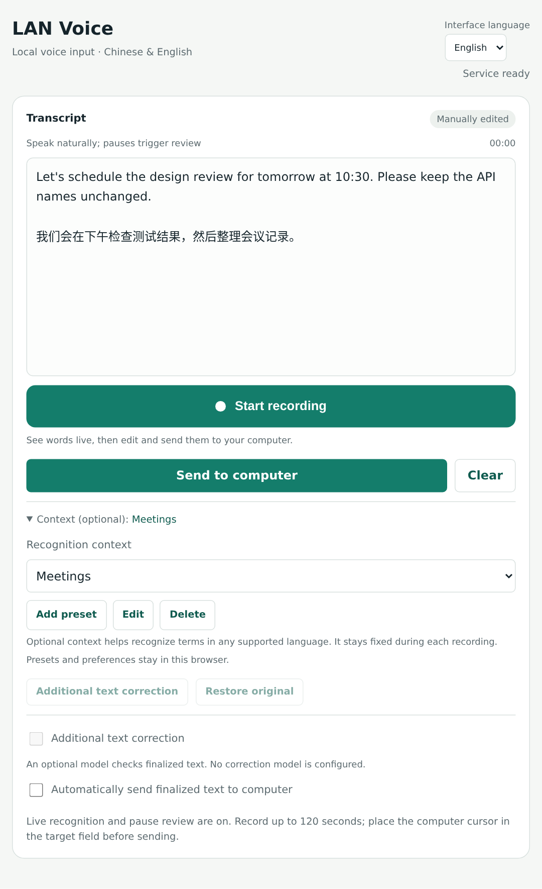
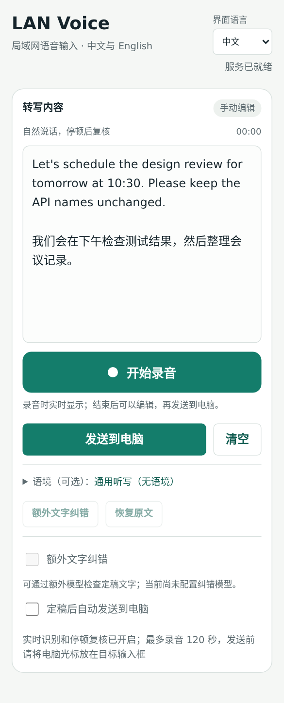
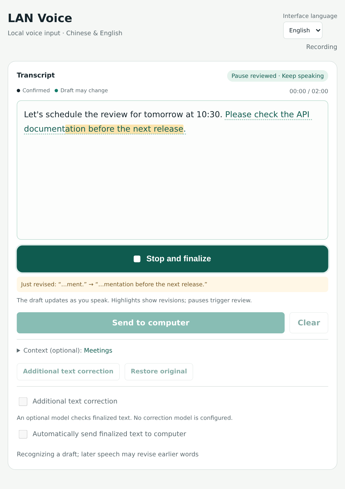

# LAN Voice

**[English](README.md) · [简体中文](README.zh-CN.md)**

把手机变成电脑的麦克风，在局域网内进行本地中英文语音输入。

LAN Voice 在电脑上提供一个 HTTPS 网页。手机打开后即可说中文、英文或中英混合语音，实时查看草稿及回改，结束后编辑定稿，再发送到电脑。

<table>
  <tr>
    <td width="72%"></td>
    <td width="28%"></td>
  </tr>
</table>

截图展示真实界面，使用通用示例文字与模拟识别响应，不代表识别准确率。

<details>
  <summary>查看实时草稿与回改</summary>
  
</details>

- **本地识别。** 音频在电脑上的模型中处理，无需云端语音服务账号。
- **可回改的实时文字。** Qwen3-ASR-1.7B 在录音中更新草稿，停顿或结束后复核完整语句，短暂高亮实际修订。
- **中文、英文和混合语音。** 自动识别语种；界面可独立切换 English / 简体中文。
- **可选语境。** 提供通用听写、会议记录、软件开发，支持预设增删改和自定义背景，也可以留空。
- **先查看，再发送。** 定稿可编辑，可选自动发送；提供 Linux X11 粘贴桥接和不操作桌面的 dry-run 模式。
- **CPU 兼容方案。** SenseVoice ONNX 通过累计音频快照更新文字；标点整理及独立语言模型文字纠错均可选。

## 安装

服务端支持的部署环境是 Linux、Python 3.10–3.12、Bash、`ffmpeg` 和 `openssl`。Qwen 原生流式模式还需要兼容的 NVIDIA GPU、驱动及 vLLM 运行环境。首次安装依赖和下载模型需要联网。

Ubuntu / Debian 系统依赖：

```bash
sudo apt install python3-venv ffmpeg openssl
```

如果需要向 X11 桌面窗口粘贴，还需安装：

```bash
sudo apt install python3-tk libx11-6 libxtst6
```

在项目目录准备 Qwen 原生流式模式：

```bash
python3 scripts/setup.py --ui-language zh-CN environment --backend streaming
python3 scripts/setup.py --ui-language zh-CN models --model qwen3-native
bash run_streaming.sh --dry-run --ui-language zh-CN
```

下载器将官方权重保存在 `.local/models/Qwen3-ASR-1.7B`，支持中断续传并校验文件大小和 SHA256。固定版本的运行依赖需要与你的 GPU 和驱动兼容；项目不会安装或修改显卡驱动。

CPU 方案及详细配置见[安装与使用说明](docs/usage.zh-CN.md#cpu-方案)。

## 使用

使用服务脚本启动、查看、重启或停止本地服务：

```bash
bash voice-service.sh start
bash voice-service.sh status
bash voice-service.sh stop
```

脚本会把进程号写入 `.local/server.pid`，并将启动输出追加到 `.local/server.log`。

1. 手机与电脑连接同一局域网，打开终端打印的局域网 `https://` 地址；出现本地证书提示时允许访问。
2. 允许麦克风权限，点击文字区下方的“开始录音”。自然说话，句间停顿，可以看到已确认内容与可回改草稿。
3. 点击“结束并定稿”，检查并编辑结果，重点核对名称、数字和否定词。初次试用可朗读[测试文本](TEST_READING.zh-CN.md)。
4. 需要实际粘贴时，先停止 dry-run 服务，再运行 `bash run_streaming.sh`。将 Linux X11 电脑的光标放到目标输入框，随后在手机点击“发送到电脑”。

自动发送会等待定稿。如果已有草稿但最终复核失败，页面会保留草稿供检查，不会自动发送。在终端按 `Ctrl+C` 停止服务。

## 系统支持

| 组件 | 支持情况 |
| --- | --- |
| Linux + NVIDIA GPU 服务端 | 通过 vLLM 运行 Qwen3-ASR-1.7B 原生流式识别 |
| Linux CPU 服务端 | SenseVoice ONNX 累计快照更新 |
| Linux X11 桌面粘贴 | 使用 Tk、X11 剪贴板及 XTest `Ctrl+V` 实现 |
| Linux Wayland 或无 X11 的服务端 | 可用 `--dry-run` 录音、转写和编辑；没有 Wayland 粘贴桥接 |
| 手机及电脑网页 | 需要支持 HTTPS 麦克风与 MediaRecorder 的新版浏览器；界面语言与识别语种独立 |
| macOS / Windows 桌面 | 可用网页连接 Linux 服务端；未验证本机服务部署，也未实现原生桌面粘贴 |

## 隐私与限制

音频通过局域网 HTTPS 传输，在电脑本地识别。应用不会把录音长期保存为录音库。可选文字纠错 API 接收的是转写文本，其服务设置独立于 ASR；语境预设与界面偏好保存在当前浏览器。

访问网址包含能使用服务及发送文字的 token，请只交给可信设备。token、TLS 私钥、环境、模型下载和运行文件保存在已忽略的 `.local/`，不应进入源码仓库。项目面向局域网，不提供公网部署或多用户隔离。

单次录音上限为 120 秒 / 25 MiB，发送文字上限为 20,000 字符。名称、口音、噪声和否定句仍可能识别出错或改变含义。网页在 HTTP 快照结果到达时更新，不是逐字符 token 推送；首批文字需要等待录音片段、网络传输和推理。

## 文档

- [安装、配置、语境预设与 API](docs/usage.zh-CN.md)
- [测试方法与验证边界](docs/testing.zh-CN.md)
- [朗读测试文本](TEST_READING.zh-CN.md)
- [贡献说明](CONTRIBUTING.zh-CN.md)
- [模型与第三方许可](docs/third-party.zh-CN.md)
- [English documentation](README.md)

## 许可

应用代码使用 [MIT 许可](LICENSE)。模型权重和依赖有各自的许可，见[第三方说明](docs/third-party.zh-CN.md)及 [NOTICE](NOTICE)。源码包不包含模型权重。
